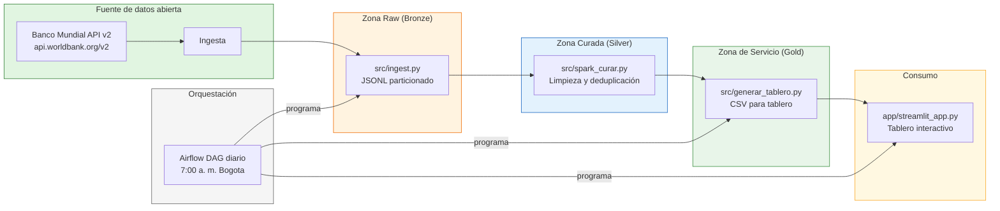

# Proyecto Pipeline de Datos

Pipeline de datos masivos que ingesta indicadores macroeconómicos desde la **API del Banco Mundial (World Bank Open Data API v2)**, los procesa con PySpark, los carga a PostgreSQL (zona de servicio) y los visualiza en un tablero de Streamlit.

> Proyecto académico — Fases 1 a 7 ejecutadas y documentadas. Fuente: Banco Mundial con **20,000+ registros** (49 países × 10 indicadores × 36 años).

---

## 1 · Fuente, pregunta y arquitectura

### Fuente de datos abierta

| Campo | Valor |
|-------|-------|
| **API** | Banco Mundial — World Bank Open Data API v2 |
| **URL** | `https://api.worldbank.org/v2` |
| **Registros** | 64,215 filas en CSV (49 países × 10 indicadores × 36 años) ✅ supera el requisito de 20,000+ |
| **Columna de fecha** | `fecha` (año, formato YYYY) |
| **Actualización** | Periódica (según indicador) |
| **Descripción** | Indicadores macroeconómicos: inflación, desempleo, crecimiento del PIB, PIB per cápita, población, esperanza de vida, comercio % PIB, tipo de cambio, remesas, emisiones CO₂ |

### Definición de `id_registro`

```
id_registro = SHA256(país + indicador + fecha)[:16]
```

| Componente | Valor ejemplo | Justificación |
|------------|---------------|---------------|
| `país` | `COL` | Identifica el país (código ISO 3166-1 alpha-3) |
| `indicador` | `inflacion_anual_pct` | Distingue el tipo de indicador |
| `fecha` | `2026` | Identifica el año del dato |

**Razón:** Un mismo país puede tener múltiples indicadores en un mismo año, y un mismo indicador se repite a lo largo de los años. La combinación garantiza unicidad sin duplicados.

### Pregunta principal

> ¿Cómo han evolucionado la inflación, el desempleo, el crecimiento del PIB, la población y otros indicadores macroeconómicos en Colombia y países de referencia durante las últimas tres décadas, y cómo se comparan frente al promedio mundial?

### Quién usaría los indicadores

| Usuario | Uso de los indicadores |
|---------|------------------------|
| Analistas financieros | Modelos de valuación, riesgo país y cobertura cambiaria |
| Importadores / Exportadores | Planificación de costos en divisas y estrategia comercial |
| Economistas | Seguimiento de política monetaria, fiscal y estructural |
| Estudiantes de economía | Trabajos de grado y análisis de series temporales |
| Inversionistas | Decisiones de asignación de activos y mercados emergentes |
| Funcionarios públicos | Diseño y evaluación de políticas públicas |
| Ciudadanos | Seguimiento del poder adquisitivo y evolución del dólar |

---

## 2 · Diagrama de arquitectura por zonas



### ¿Es arquitectura Lambda o Kappa?

**Tipo Kappa**, con el siguiente razonamiento:

| Característica | Implementación en este proyecto |
|----------------|--------------------------------|
| **Un solo flujo** | Todos los datos siguen la misma ruta: API → JSONL (raw) → CSV (servicio) → Streamlit |
| **Sin pipeline batch separado** | No hay dos pipelines paralelos (batch + speed). Solo uno unificado |
| **Reprocesamiento** | Si se necesitan datos históricos, se vuelve a ejecutar `src/ingest.py` sobre el mismo rango de fechas |
| **Log inmutable** | Los JSONL en `datos/raw/` actúan como el registro inmutable de entrada |

No es Lambda puro porque no mantenemos una capa batch (HDFS/Spark para histórico) y otra capa speed (Kafka streaming para tiempo real) operando en paralelo. Usamos un único flujo unificado que puede reejecutarse cuando sea necesario.

---

## 3 · Flujo de datos (fases 1 a 7)

| Fase | Componente | Acción | Entrada | Salida |
|------|-----------|--------|---------|--------|
| 1 | `src/ingest.py` | Ingesta desde API del Banco Mundial con paginación y reintentos | api.worldbank.org/v2 | JSONL en `datos/raw/fecha_ingesta=*/` |
| 2 | `src/spark_curar.py` | Limpieza, eliminación de duplicados, validación (PySpark) | JSONL raw | Datos curados (sin duplicados por `id_registro`) |
| 3 | `src/generar_tablero.py` | Generación de CSV y JSON agregado | Datos curados | `datos/servicio/indicadores_servicio.csv` |
| 4 | `app/streamlit_app.py` | Tablero interactivo con filtros y descarga | CSV de servicio | Visualización en navegador |
| 5 | `airflow/dags/indicadores_diario.py` | Orquestación diaria programada | — | Ejecución automática a las 7:00 a. m. |

> **Nota:** Las fases de Kafka, HDFS y Hive (del pipeline académico original) están implementadas en `src/kafka_producer.py`, `src/kafka_consumer.py`, `src/hdfs_writer.py` y `src/hive_tablas.py`, pero el flujo principal de ejecución actual usa directamente `src/ingest.py` → `src/generar_tablero.py` → `app/streamlit_app.py` sin requerir infraestructura contenedorizada.

---

## 4 · Estructura del repositorio

```
proyecto_pipeline_datos/
├── app/                    # Tablero Streamlit (fase 7)
│   └── streamlit_app.py
├── datos/
│   ├── raw/                # Zona raw (JSONL) — particionado por fecha_ingesta
│   │   └── fecha_ingesta=2026-11-22/
│   └── servicio/           # Zona de servicio (CSV/JSON)
│       ├── indicadores_servicio.csv      (64,215 filas)
│       └── indicadores_agregados.json    (1,117 filas)
├── evidencias/             # Capturas y salidas del proyecto
│   └── LEEME.md
├── notebooks/              # Notebook ejecutado (fases 1 a 7)
│   └── Proyecto_Pipeline_Datos.ipynb
├── src/                    # Código fuente por fase
│   ├── ingest.py           # Fase 1: Ingesta desde API Banco Mundial
│   ├── spark_curar.py      # Fase 4: Procesamiento PySpark (curado)
│   ├── generar_tablero.py  # Fase 3: Generación CSV para el tablero
│   ├── kafka_producer.py   # Fase 2: Productor Kafka (opcional)
│   ├── kafka_consumer.py   # Fase 2: Consumidor Kafka (opcional)
│   ├── hdfs_writer.py      # Fase 3: Escritura HDFS (opcional)
│   ├── hive_tablas.py      # Fase 5: Tablas externas Hive (opcional)
│   ├── postgres_servir.py  # Fase 6: Zona de servicio PostgreSQL (opcional)
│   └── __init__.py
├── airflow/                # Fase 8: Orquestación Airflow
│   └── dags/
│       └── indicadores_diario.py
├── docker-compose.yml      # Infraestructura contenedorizada (opcional)
├── requirements.txt        # Dependencias de Python
├── .gitignore
└── README.md               # Este archivo
```

---

## 5 · Inicio rápido (Windows PowerShell)

### 1. Clonar y crear entorno virtual

```powershell
cd proyecto_pipeline_datos
python -m venv .venv
.venv\Scripts\Activate.ps1
pip install -r requirements.txt
```

### 2. Ejecutar la ingesta (Fase 1)

Descarga indicadores del Banco Mundial (49 países × 10 indicadores × 36 años):

```powershell
python src/ingest.py
```

Esto generará archivos JSONL en `datos/raw/fecha_ingesta=AAAA-MM-DD/`.

### 3. Generar el CSV de servicio (Fase 3)

Lee todos los JSONL de la zona raw y genera el CSV que consume el tablero:

```powershell
python src/generar_tablero.py
```

Esto crea:
- `datos/servicio/indicadores_servicio.csv`
- `datos/servicio/indicadores_agregados.json`

### 4. Lanzar el tablero Streamlit (Fase 4)

```powershell
python -m streamlit run app/streamlit_app.py --server.port 8502
```

El tablero se abre en `http://localhost:8502`.

En la barra lateral izquierda encontrarás el botón **🔄 Refrescar datos** para recargar el CSV sin cerrar el tablero.

---

## 6 · Datos

| Ruta | Contenido | Filas |
|------|-----------|-------|
| `datos/raw/fecha_ingesta=*/indicadores_parte_*.jsonl` | Zona raw (JSONL de la API Banco Mundial) | ~14,112 por ejecución |
| `datos/servicio/indicadores_servicio.csv` | Zona de servicio (CSV para el tablero) | 64,215 filas acumuladas |
| `datos/servicio/indicadores_agregados.json` | Agregados por país, indicador, año | 1,117 filas |

> Los datos se acumulan en `datos/raw/` a cada ejecución de `ingest.py`. El CSV de servicio se regenera leyendo todos los JSONL disponibles.

---

## 7 · Evidencias

La carpeta `evidencias/` contiene:
- `LEEME.md`: guía de capturas y salidas requeridas (Kafka, HDFS, MapReduce vs Spark, idempotencia, streaming tras reiniciar)

---

## 8 · Requerimientos

Ver `requirements.txt`. Principales dependencias:

| Categoría | Paquetes |
|-----------|----------|
| Ingesta | `requests` |
| Procesamiento | `pyspark>=3.5.0` |
| Servicio | `pg8000>=1.31.0`, `sqlalchemy>=1.4.36,<2.0` |
| Tablero | `streamlit>=1.35.0`, `pandas>=2.2.0`, `plotly>=5.20.0` |
| Orquestación | `apache-airflow>=2.9.0`, `pendulum>=3.0.0` |
| Utilidades | `python-dotenv`, `pytest`, `jupyter`, `ipywidgets` |

> **Nota:** `kafka-python`, `hdfs` y `pyhive` están en el código pero no son estrictamente necesarios para el flujo principal. Se importan condicionalmente con `try/except`.

---

## 9 · Notas

- El `id_registro` se calcula como `SHA256(país + indicador + fecha)[:16]` para evitar duplicados al reejecutar la ingesta.
- `generar_tablero.py` lee todos los JSONL de `datos/raw/` (incluyendo ejecuciones previas), por lo que el CSV acumulado crece con cada ingesta.
- El tablero usa el CSV de respaldo si no hay PostgreSQL disponible; para usar PostgreSQL real, configura las variables de entorno `POSTGRES_HOST`, `POSTGRES_PORT`, `POSTGRES_DB`, `POSTGRES_USER`, `POSTGRES_PASSWORD`.
- Las credenciales en `docker-compose.yml` son de ejemplo. En producción usar un archivo `.env` fuera del repositorio.