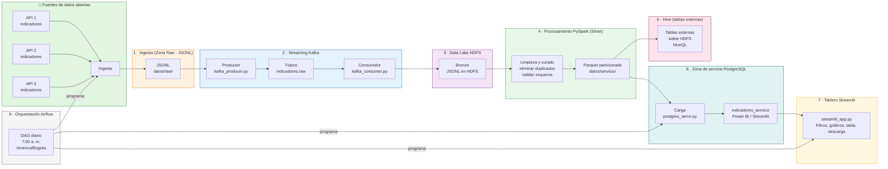

# Proyecto Pipeline de Datos

Pipeline de datos masivos que ingesta indicadores económicos desde APIs abiertas, los procesa con Apache Kafka, HDFS, PySpark y Hive, los carga a PostgreSQL (zona de servicio) y los visualiza en un tablero de Streamlit.

> Proyecto académico — Fases 2 a 8 ejecutadas y documentadas.

---

## Estructura del repositorio

```
proyecto_pipeline_datos/
├── app/                    # Tablero Streamlit (fase 7)
│   └── streamlit_app.py
├── datos/
│   ├── raw/                # Zona raw (JSONL) — muestra de ingesta
│   └── servicio/           # Zona de servicio (CSV/Parquet) — para Power BI / Streamlit
├── evidencias/             # Capturas y salidas (Kafka, HDFS, Spark, idempotencia)
├── notebooks/              # Notebook ejecutado (fases 2 a 8)
│   └── Proyecto_Pipeline_Datos.ipynb
├── src/                    # Código fuente por fase
│   ├── ingest.py           # Fase 1: Ingesta desde APIs
│   ├── kafka_producer.py   # Fase 2: Productor Kafka
│   ├── kafka_consumer.py   # Fase 2: Consumidor Kafka
│   ├── hdfs_writer.py      # Fase 3: Escritura HDFS
│   ├── spark_curar.py      # Fase 4: Procesamiento PySpark
│   ├── hive_tablas.py      # Fase 5: Tablas externas Hive
│   ├── postgres_servir.py  # Fase 6: Zona de servicio PostgreSQL
│   └── generar_tablero.py  # Fase 7: Exportación para tablero
├── airflow/                # Fase 8: Orquestación Airflow
│   └── dags/
│       └── indicadores_diario.py
├── docker-compose.yml      # Infraestructura contenedorizada
├── requirements.txt        # Dependencias de Python
└── README.md               # Este archivo
```

---

## Diagrama de arquitectura



---

## Flujo de datos (8 fases)

| Fase | Componente | Acción | Salida |
|------|-----------|--------|--------|
| 1 | `src/ingest.py` | Ingesta desde APIs abiertas | JSONL en `datos/raw/` |
| 2 | `src/kafka_producer.py` / `kafka_consumer.py` | Publicar y consumir en Kafka | Tópico `indicadores.raw` |
| 3 | `src/hdfs_writer.py` | Escribir en HDFS | Capa bronze en HDFS |
| 4 | `src/spark_curar.py` | Limpiar, deduplicar, validar (PySpark) | Capa silver (Parquet) |
| 5 | `src/hive_tablas.py` | Tablas externas en Hive sobre HDFS | Esquema SQL sobre el lago |
| 6 | `src/postgres_servir.py` | Cargar a PostgreSQL | Zona de servicio |
| 7 | `app/streamlit_app.py` | Tablero interactivo | Visualización y descarga |
| 8 | `airflow/dags/indicadores_diario.py` | Orquestar todo el pipeline | Ejecución diaria automática |

---

## Inicio rápido

### 1. Clonar y crear entorno

```bash
cd proyecto_pipeline_datos
python -m venv .venv
source .venv/bin/activate   # Linux/Mac
# .venv\Scripts\Activate.ps1  # Windows (PowerShell)

pip install -r requirements.txt
```

### 2. Levantar infraestructura con Docker

Perfiles disponibles para no encender todo a la vez:

```bash
# Solo Kafka (~700 MB)
docker compose --profile kafka up -d

# Kafka + HDFS (~2 GB)
docker compose --profile kafka --profile hdfs up -d

# Todo incluido (Kafka, HDFS, Spark, Hive, PostgreSQL, Airflow)
docker compose --profile todo up -d --build
```

### 3. Ejecutar el pipeline (fases 1 a 6)

```bash
# Fase 1: Ingesta
python src/ingest.py

# Fase 2: Productor Kafka
python src/kafka_producer.py

# Fase 3: Escritura HDFS
python src/hdfs_writer.py

# Fase 4: Curado con PySpark
python src/spark_curar.py

# Fase 6: Cargar a PostgreSQL
python src/postgres_servir.py
```

### 4. Lanzar el tablero Streamlit (fase 7)

```bash
streamlit run app/streamlit_app.py
```

El tablero se abre en `http://localhost:8501`.

---

## Datos

- **Zona raw (`datos/raw/`):** muestra de JSONL ingresada desde las APIs (no el dataset completo si es muy pesado).
- **Zona de servicio (`datos/servicio/`):** CSV y Parquet con las tablas listas para consumir (Power BI, Streamlit).

---

## Evidencias

La carpeta `evidencias/` contiene:
- Salidas/capturas del tópico de Kafka (tópico y consumidor)
- HDFS: `hdfs dfs -ls` de la zona bronze
- Comparación MapReduce frente a Spark
- Pruebas de idempotencia (re-ejecución sin duplicados)
- Streaming tras reiniciar los servicios

---

## Requerimientos

Ver `requirements.txt`. Principales dependencias:

- `pyspark`, `kafka-python`, `hdfs`, `pyhive`
- `psycopg2-binary`, `sqlalchemy` (PostgreSQL)
- `streamlit`, `pandas`, `plotly` (tablero)
- `apache-airflow` (orquestación)
- `pytest`, `jupyter` (pruebas y notebook)

---

## Notas

- Los contenedores de Spark son efímeros: se levantan bajo demanda y se borran al terminar.
- Hive usa un metastore Derby embebido (adecuado para aprendizaje; en producción usar PostgreSQL/MySQL externo).
- Las credenciales en `docker-compose.yml` son de ejemplo. En producción usar un archivo `.env` fuera del repositorio.
